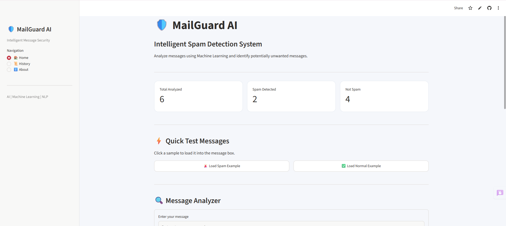
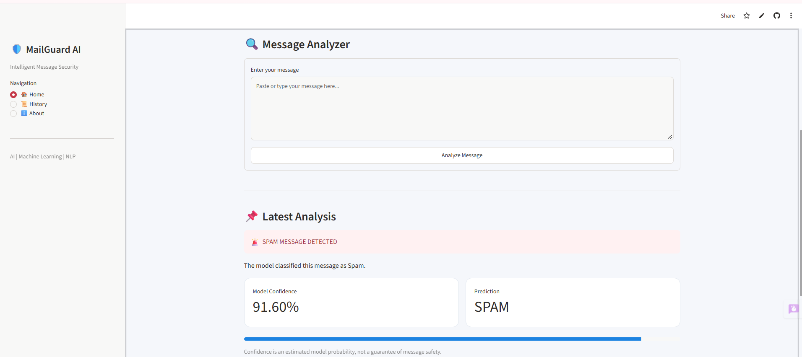
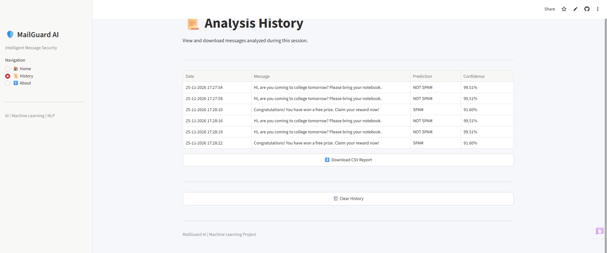

# MailGuard AI – SMS Spam Detection System

## Project Overview
MailGuard AI is a Machine Learning-based application designed to classify text messages as Spam or Not Spam.

The application provides a simple and user-friendly interface using Streamlit.

## Problem Statement
Unwanted spam messages can create inconvenience and may contain misleading information. This project uses Machine Learning to identify potentially unwanted messages.

## Technologies Used
- Python
- Machine Learning
- Scikit-learn
- TF-IDF Vectorization
- Multinomial Naive Bayes
- Streamlit
- Pandas
- GitHub

## Features
- Spam and Not Spam classification
- Prediction confidence display
- Prediction history
- CSV download
- Clear history option
- Interactive dashboard
- Web-based application

  ## Application Screenshots

### 1. Home Dashboard

### 2. Spam Prediction

### 3. Analysis History

## Machine Learning Workflow
1. Load the SMS Spam Collection dataset.
2. Preprocess the text messages.
3. Convert text into numerical features using TF-IDF.
4. Train a Multinomial Naive Bayes model.
5. Save the trained model and vectorizer.
6. Deploy the application using Streamlit Community Cloud.

 ## Dataset Details

This project uses the SMS Spam Collection Dataset.

- Total Messages: 5,572
- Ham (Legitimate Messages): 4,825
- Spam Messages: 747
- Data Type: Text Messages
- Target Classes: Spam and Ham

The dataset is used to train a machine learning model
to identify unwanted messages.

## Data Processing

1. Load the SMS dataset.
2. Prepare and clean the text messages.
3. Convert text into numerical features using TF-IDF.
4. Train the Multinomial Naive Bayes classifier.

 ## Testing Information

The application was tested using sample spam and legitimate messages.

| Test Case | Expected Result | Status |
|---|---|---|
| Spam message input | Spam prediction | Passed |
| Normal message input | Not Spam prediction | Passed |
| Prediction History | Display history | Passed |
| CSV Download | Download history | Passed |
| Clear History | Clear saved history | Passed |

All the above functional tests were confirmed
during application testing.  

## Project Files
- `app.py` – Streamlit application
- `train_model.py` – Model training
- `data_exploration.py` – Dataset exploration
- `spam_model.pkl` – Trained ML model
- `vectorizer.pkl` – TF-IDF vectorizer
- `requirements.txt` – Project dependencies

## Future Enhancements
- Improve model performance with additional datasets.
- Support email message classification.
- Add more advanced text preprocessing.
- Improve the user interface.

## Author
S. Swetha

AI & Data Science Student

## Disclaimer
This application is an educational project. Predictions are model estimates and may not always be correct.
## Live Demo

[🚀 Open MailGuard AI](https://emailspamdetection-4hch8eu42fk6epkbtvtgxk.streamlit.app/)

